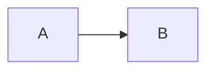

<div align = "center">

# younisekai

**一个支持后台管理的静态博客模板 · A CMS integrated static blog template**

基于 Astro 5 + Tailwind CSS v4 + Svelte 5，构建产物是纯静态文件，可以部署到任何静态托管上。

[功能](#功能) · [快速开始](#快速开始) · [配置](#配置) · [写作](#写作) · [后台管理](#后台管理decape-cms) · [部署](#部署) · [与上游的差异](#与上游-twilight-的差异)

</div>

---

## 这是什么

younisekai 是一个「带着后台管理」的静态博客模板：写作内容全部是磁盘上的 Markdown / JSON 文件，构建后是一堆静态 HTML，**没有数据库、没有服务端框架**；同时又可以通过 `/admin` 后台在浏览器里可视化地写文章、改配置、上传图片，内容以 Git 提交的形式回到仓库。

项目移植并改造自 [Spr-Aachen/Twilight](https://github.com/Spr-Aachen/Twilight)（MIT 许可），沿用了它的配置体系、色相（hue）主题系统、三栏布局与大部分组件，并按需要做了裁剪与改名，去掉了看板娘、音乐播放器、动画列表、在线翻译、ECharts 统计图表与 og 图生成等子系统（详见 [与上游的差异](#与上游-twilight-的差异)）。

## 功能

**外观**

- 横幅（Banner）首页：壁纸轮播 / Ken Burns 效果 / 水波纹 / 打字机副标题
- 三种壁纸模式：`banner` 横幅、`fullscreen` 全屏、`none` 纯色，访客可在导航栏随时切换
- 全站配色由单个 `--hue` 变量经 oklch 派生，导航栏自带色相滑块，访客可随手换主题色
- 深色 / 浅色主题，默认跟随系统，也可手动切换并记住选择
- 三栏网格布局（左右侧栏 + 正文），左右侧栏由配置驱动的「挂件」组成，响应式断点已针对窄屏调整
- Swup 页面过渡、加载遮罩、返回顶部、粒子特效

**写作**

- 文章是 `src/content/posts/` 下的 `.md` / `.mdx` 文件，支持子目录（目录可作为分类层级）与嵌套分类
- 归档页支持按分类 / 标签即时筛选；侧栏有目录树、分类、标签挂件
- 文章目录（TOC）滚动高亮、阅读时长、字数统计、最后编辑时间
- 代码块：行号、语言标签、折叠段、复制按钮，深浅色双主题
- 数学公式（KaTeX）、Mermaid 图表、提示框（admonitions / callouts）、GitHub 仓库卡片
- 图片灯箱（Fancybox）、图片懒加载
- 文章加密（AES + 密码）、复制保护（禁选中 / 禁复制 / 禁右键 / 禁开发者工具），可按文章开关
- 草稿（`draft: true`）只在本地预览出现，不会进入构建产物
- 许可证（License）区块、上一篇 / 下一篇导航

**集成**

- 全文搜索：[Pagefind](https://pagefind.app/)（构建时生成索引，纯静态、无需第三方服务）
- 评论：Waline 或 Twikoo，可按配置自动选择
- 订阅：RSS + Atom，外加 sitemap、robots.txt
- 多语言界面：内置简体中文、繁體中文、English、日本語四套界面文案，可自行扩展
- 后台管理：Decap CMS（`/admin`），支持 GitHub OAuth 在线登录，也支持本地 `decap-server` 写稿

## 快速开始

需要 Node.js 20 或更高版本（推荐 22）。

```bash
npm install          # 安装依赖
npm run dev          # 本地开发，默认 http://localhost:4321
npm run build        # 构建静态站点到 dist/
npm run preview      # 预览构建结果
```

> Windows 用户如果 PowerShell 提示脚本被禁用，用 `npm.cmd run dev` 或改用 Git Bash / CMD。

## 目录结构

```
younisekai/
├─ younisekai.config.yaml     ← 站点配置（站名、导航、侧栏、评论、壁纸……都在这）
├─ .decap.yml                 ← Decap CMS 后台配置（字段与 content.config.ts 对应）
├─ astro.config.mjs           ← Astro 配置（集成、Markdown 管线、是否启用 SSR 适配器）
├─ pagefind.yml               ← Pagefind 搜索索引配置
├─ public/                    ← 静态资源
│  ├─ assets/images/          ← 壁纸、头像、封面、占位图（npm run assets 可重新生成）
│  ├─ favicon/                ← 站点图标
│  └─ FooterConfig.html       ← 页脚自定义 HTML（footer.enable 打开时注入）
├─ scripts/
│  ├─ new-post.js             ← npm run new-post：新建文章
│  ├─ generate-icons.js       ← 构建时扫描图标用法，生成 src/utils/icons.ts
│  ├─ generate-assets.mjs     ← npm run assets：生成占位素材
│  └─ build-with-pagefind.cjs ← 构建后自动跑 Pagefind
└─ src/
   ├─ config.ts               ← 读取并校验 younisekai.config.yaml
   ├─ types/config.ts         ← 配置项的类型定义
   ├─ content.config.ts       ← 文章 frontmatter 的校验规则（改字段先改这里）
   ├─ content/                ← 全部内容
   │  ├─ posts/               ← 文章（支持子目录）
   │  ├─ about.md             ← 「关于」页
   │  ├─ friends.md           ← 「友链」页
   │  ├─ friends/*.json       ← 友链数据
   │  ├─ projects/ skills/ timeline/ diary/ albums/   ← 项目 / 技能 / 历程 / 日记 / 相册
   ├─ layouts/                ← base.astro（全站骨架）与 grid.astro（三栏网格）
   ├─ components/             ← 组件（导航栏、横幅、侧栏挂件、文章卡片、评论……）
   ├─ pages/                  ← 路由
   ├─ styles/                 ← 样式（variables.styl 里是那套色相变量）
   ├─ i18n/                   ← 界面多语言
   ├─ plugins/                ← Markdown 插件（remark / rehype / expressive-code）
   └─ utils/                  ← 工具函数（内容查询、分类、标签、主题、壁纸……）
```

## 配置

站点的一切配置都在根目录的 **`younisekai.config.yaml`** 里，改完重启 dev（或重新构建）即可生效。

| 配置段 | 作用 |
| --- | --- |
| `site` | 站点 URL、标题、副标题、语言、时区、字体、主题色相、默认深浅色、壁纸、加载页、favicon |
| `navbar.links` | 顶部导航菜单，可用预设（`Home` / `Archive` / `Projects` / `Skills` / `Timeline` / `Diary` / `Albums` / `About` / `Friends`）或自定义链接与多级子菜单 |
| `sidebar.components` | 左右侧栏的挂件列表、顺序、粘性位置与页面可见性规则 |
| `profile` | 头像、昵称、简介、社交链接 |
| `announcement` | 公告挂件的标题、内容、是否可关闭、附带的链接 |
| `post` | 文章卡片封面样式、标题字号、最后编辑时间、代码高亮主题、许可证、评论 |
| `footer` | 页脚自定义 HTML 注入（备案号之类） |
| `particle` | 粒子特效的数量、尺寸、透明度、速度 |

几个常用项：

```yaml
site:
    siteURL: "https://younisekai.example.com/"   # 部署前务必改成自己的域名
    title: "younisekai"
    subtitle: "异世界手记"
    lang: "zh_CN"          # 界面语言
    defaultTheme: "dark"   # system | light | dark
    themeColor:
        hue: 265           # 0-360，主题色相；访客也能在导航栏里自己调
    wallpaper:
        mode: "banner"     # banner | fullscreen | none
```

## 写作

### 新建文章

```bash
npm run new-post -- "文章标题"
npm run new-post -- "读书笔记" --tags 读书,随笔
```

也可以直接在 `src/content/posts/` 里新建 `.md` 文件（推荐用 ASCII 文件名，避免 URL 转义带来的麻烦）。

### frontmatter 字段

```yaml
---
title: "文章标题"                # 必填
directoryTitle: ""               # 选填：侧栏目录树里该文章节点的显示名（留空则用 title）
description: "一句话摘要"         # 列表卡片、搜索结果、RSS 里显示
published: 2026-01-01            # 发布日期
updated: 2026-01-08              # 修改日期（会显示「最后编辑」）
cover: "/assets/images/covers/cover-01.svg"   # 卡片封面（支持 /public 下的绝对路径或内容目录内的相对路径）
coverInContent: false            # 是否在文章正文开头也显示封面
category: ["技术", "前端"]        # 分类，字符串或数组（数组即嵌套分类）
tags: ["Astro", "教程"]          # 标签
lang: "zh_CN"                    # 文章语言
pinned: false                    # 置顶
author: ""                       # 覆盖全局作者
sourceLink: ""                   # 原文链接（转载时用）
licenseName: "CC BY-NC-SA 4.0"   # 覆盖全局许可证
licenseUrl: "https://creativecommons.org/licenses/by-nc-sa/4.0/"
comment: true                    # 是否允许评论
draft: false                     # 草稿：只在 dev 出现，不进入构建产物
encrypted: false                 # 加密文章
password: ""                     # 加密密码（encrypted: true 时必填）
copyProtection:                  # 复制保护（按需开启）
    blockSelection: false        # 禁止选中
    blockClipboard: false        # 禁止复制
    blockContextMenu: false      # 禁止右键
    blockDevTools: false         # 禁止 F12 / 开发者工具
routeName: ""                    # 自定义路由名（默认用文件名）
---
```

### 目录、分类与标签

- 放进子目录就是目录层级：`posts/guide/getting-started.md` → `/posts/guide/getting-started/`
- 侧栏「目录树」挂件按文章路径自动生成：**文章节点**的显示名可用该文章的 `directoryTitle` 覆盖，
  而**目录节点**的显示名就等于目录名本身（例如 `guide`）。想让目录节点也显示中文，
  可以直接用中文目录名（URL 会变成百分号编码），或者改 `src/utils/directory.ts` 里的命名逻辑
- 以 `_` 开头的文件不会被当作文章（适合放写作模板或草稿碎片，仓库里的 `posts/_frontmatter-template.md` 就是例子）
- `category` 写数组就是嵌套分类，侧栏与归档页会按层级展示
- `tags` 会自动汇总成标签云，点标签进入归档页筛选结果

### Markdown 扩展

````markdown
:::note
提示框：支持 note / tip / important / warning / caution 等类型
:::



行内公式 $E = mc^2$，块级公式：

$$
\int_0^1 x^2 dx = \frac{1}{3}
$$

::github{repo="yourname/younisekai"}
````

代码块支持行号、语言标签、折叠段与复制按钮；图片会自动接入灯箱。

## 素材与图片

- 放在 `public/` 下的文件会原样出现在站点根路径，例如 `public/assets/images/foo.jpg` → `/assets/images/foo.jpg`
- 仓库自带的壁纸 / 头像 / 封面都是脚本生成的 SVG 占位图，跑 `npm run assets` 可以重新生成（配色跟着 `--hue` 走），换成自己的图片后记得同步改 `younisekai.config.yaml` 里的路径
- 后台（`/admin`）上传的图片默认进 `public/assets/images/`（可在 `.decap.yml` 里改 `media_folder`）

## 搜索

搜索用 [Pagefind](https://pagefind.app/)：`npm run build` 会自动在 `dist/pagefind/` 生成索引，导航栏的搜索框直接查它。

- **索引只在构建后存在**，所以 `npm run dev` 下搜索不可用，想验证搜索请跑 `npm run build && npm run preview`
- 不想被索引的内容可以加 `data-pagefind-ignore` 属性（正文标题旁的 `#` 锚点已经加了）

## 评论

在 `younisekai.config.yaml` 里配置：

```yaml
post:
    comment:
        enable: true
        provider: "waline"     # 留空则自动选择已配置的那个
        waline:
            serverURL: "https://your-waline.example.com"
        twikoo:
            envId: "https://your-twikoo.example.com"
```

Waline 的 `serverURL` 与 Twikoo 的 `envId` 只要填了一个，就能被自动识别；显式指定的 `provider` 没配置好时构建会直接报错，避免上线后评论区空着。

## 多语言

界面文案在 `src/i18n/`：

```
src/i18n/
├─ i18nKey.ts            ← key 枚举
├─ language.ts           ← 语言表（语言代码、显示名）
├─ translation.ts        ← 取词函数
└─ languages/
   ├─ zh_hans.ts  zh_hant.ts  en.ts  ja.ts
```

加一门语言：在 `languages/` 里复制一份最接近的文件、改 key 对应的文案，然后在 `language.ts` 里登记。文章语言由 frontmatter 的 `lang` 决定（目前主要影响排序与展示）。

## 后台管理（Decap CMS）

后台入口是 `/admin`，配置在根目录 `.decap.yml`，字段与 `src/content.config.ts` 的 schema 一一对应。

### 本地写稿（零配置）

```bash
npx decap-server        # 另开一个终端
npm run dev             # 然后访问 http://localhost:4321/studio/
```

> 本地写稿依赖 Decap 的 local_backend，Sveltia 对此支持有限；本地写稿时可以把
> `PUBLIC_DECAP_CMS_SRC_URL` 设成 Decap 的地址（见 `.env.example`）。

### 用哪个编辑器

后台界面默认用 **Sveltia CMS**（Decap 的现代替代品：界面更紧凑、加载更快、保存时对未识别的
frontmatter 字段更宽容），配置在 `astro.config.mjs` 的 `CMS_SRC_URL`：

```js
// Sveltia（默认）
"https://unpkg.com/@sveltia/cms/dist/sveltia-cms.js"
// Decap CMS（官方原版）
"https://unpkg.com/decap-cms@^3.9.0/dist/decap-cms.js"
```

两者读同一份 `.decap.yml`、走同一套 `/oauth` 登录，改这一行（或设环境变量
`PUBLIC_DECAP_CMS_SRC_URL`）就能切换。

**关于"保存后字段被抹掉"**：这类 Git CMS 保存时会按 `.decap.yml` 的字段清单重写整个
frontmatter —— 不在清单里的字段会被丢掉。所以本项目的做法是：界面上只显示常用的 11 个字段，
其余（语言、作者、许可证、更新日期、加密密码等）用 `widget: hidden` 保留在配置里，
既能原样保存回文件，又不会在表单里打扰你。想手动改这些值就直接编辑文件。

### 线上登录（GitHub OAuth）

线上要能登录，需要 OAuth 服务端。本项目用的是 [decap-cms-oauth-astro](https://www.npmjs.com/package/decap-cms-oauth-astro)，它会在站点内提供 `/oauth` 与 `/oauth/callback` 路由 —— 这需要服务端渲染，所以要用支持 SSR 的平台（Cloudflare Pages / Vercel / Netlify）。

**访客与站长的区别**：站点是公开的，但后台只有你能用 —— 访客打开后台地址只会看到一张 GitHub 登录页，既看不到文章列表也改不了任何东西；权限校验发生在 GitHub 那侧（仓库是你的，别人授权不了自己的账号去写你的仓库）。后台地址默认放在 `/studio/` 这个不容易被猜到的路径上，站点里也没有任何链接指向它。

配置步骤：

1. **新建 GitHub OAuth App**：[GitHub → Settings → Developer settings → OAuth Apps → New OAuth App](https://github.com/settings/applications/new)
   - **Application name**：随意，例如 `younisekai CMS`
   - **Homepage URL**：你的站点地址，例如 `https://younisekai.pages.dev`
   - **Authorization callback URL**：站点地址 + `/oauth/callback`，例如 `https://younisekai.pages.dev/oauth/callback`
   - 注册后点 **Generate a new client secret**，记下 **Client ID** 与 **Client Secret**

2. **在部署平台配置环境变量**（本地调试可写进 `.env`）：

   ```env
   ENABLE_CMS_OAUTH=1
   OAUTH_GITHUB_CLIENT_ID=你的 client id
   OAUTH_GITHUB_CLIENT_SECRET=你的 client secret
   SITE_URL=https://你的站点地址/
   BASE_PATH=/
   ```

   `ENABLE_CMS_OAUTH=1` 会让 `astro.config.mjs` 挂上 SSR 适配器（Cloudflare / Vercel / Netlify 自动识别），不设置时构建产物是纯静态。
   后台路由可用 `ADMIN_ROUTE` 改（默认 `/studio`）。

3. **改 `.decap.yml`**：`backend.repo` 填 `你的用户名/仓库名`，`branch` 填你的分支，`site_domain` / `base_url` / `site_url` / `logo_url` 换成你的真实域名。

4. 重新部署，访问「站点地址 + `/studio/`」，用 GitHub 账号登录即可写稿；保存后 Decap 会以你的身份向仓库提交 commit，CI 会自动重新构建并发布。

> 纯静态托管（GitHub Pages 等）没有服务端路由，无法在线登录。那种情况下用编辑器直接改文件，或用上面的本地模式；也可以给静态站点单独挂一个外部 OAuth 代理（把 `base_url` 指向它）。

## 部署

`npm run build` 产出的 `dist/` 就是整站，纯静态（除非你开了 `ENABLE_CMS_OAUTH`）。

**部署前必须让「两处地址」与真实部署地址一致**，否则资源与站内链接会 404：

| 位置 | 改什么 | 根目录部署 | 子路径部署（GitHub Pages 项目站点） |
| --- | --- | --- | --- |
| `younisekai.config.yaml` | `site.siteURL` | `https://example.com/` | `https://<用户名>.github.io/<仓库名>/` |
| `astro.config.mjs` | `BASE_PATH`（同时用作 `base`） | `"/"` | `"/<仓库名>/"` |

`BASE_PATH` 会被 Astro 用在资源路径上；正文里手写的 `/posts/xxx/`、`/assets/x.png` 以及配置里的
`profile.links`、`announcement.link.url` 这类站内地址，也由 `src/plugins/rehype-base-path.mjs`
与 `resolveUrl()` 自动补上前缀，所以文章内容不需要改写法。

### GitHub Pages

仓库里带了 `.github/workflows/deploy.yml`：

1. 仓库 **Settings → Pages → Build and deployment → Source** 选 **GitHub Actions**
2. 按上表确认 `siteURL` 与 `BASE_PATH`（`https://<用户名>.github.io/<仓库名>/` 这种项目站点必须加前缀）
3. 推到 `main` 分支（或在 Actions 里手动触发 `deploy`），剩下的自动完成
4. 想用自定义域名，就在 `public/` 下加一个 `CNAME` 文件写上域名，并把 DNS 的 CNAME 记录指向 `<用户名>.github.io`，
   然后把 `siteURL` 改成 `https://你的域名/`、`BASE_PATH` 改回 `"/"`

### Cloudflare Pages（想用网页后台就选它）

Cloudflare Pages 支持服务端渲染，是"在线写稿"最省事的落点（免费额度足够个人博客）：

1. 到 [Cloudflare Dashboard](https://dash.cloudflare.com) → **Workers & Pages → Create → Pages → Connect to Git**，选中你的仓库
2. 构建设置：
   - **Framework preset**：Astro
   - **Build command**：`npm run build`
   - **Build output directory**：`dist`
   - **环境变量**（Settings → Environment variables，Production 与 Preview 都加上）：
     ```
     ENABLE_CMS_OAUTH=1
     OAUTH_GITHUB_CLIENT_ID=...     # 见「后台管理」一节
     OAUTH_GITHUB_CLIENT_SECRET=...
     SITE_URL=https://<你的项目名>.pages.dev/
     BASE_PATH=/
     NODE_VERSION=22
     ```
3. 部署完成后你会拿到 `https://<项目名>.pages.dev` —— 把这个地址填进 GitHub OAuth App 的
   Homepage URL 与 `回调地址 + /oauth/callback`，并同步更新 `.decap.yml` 里的
   `site_domain` / `base_url` / `site_url` / `logo_url`，再推一次代码
4. 之后访问 `https://<项目名>.pages.dev/studio/` 就能登录写稿

> 同一个仓库可以同时部署到 GitHub Pages（纯静态，无后台）和 Cloudflare Pages（带后台）：
> 两边的差别只由 `BASE_PATH` 与 `SITE_URL` 两个环境变量决定，`ENABLE_CMS_OAUTH` 只在 Cloudflare 那侧设置。
> 想绑自定义域名，在 Cloudflare 的 **Custom domains** 里加域名，然后把 `SITE_URL` 与 `.decap.yml` 的域名一起换掉即可。

### Netlify / Vercel

导入仓库即可，构建命令 `npm run build`，输出目录 `dist`，Node 版本 20+（推荐 22）；需要后台在线登录时按上面 Cloudflare 那节配同样的一组环境变量（`SITE_URL` / `BASE_PATH` / `ENABLE_CMS_OAUTH` / OAuth 凭据）。

### 自己的服务器

```bash
npm run build
# 把 dist/ 里的内容传到服务器，交给 Nginx / Caddy 之类的静态服务
```

或者用仓库里的 Dockerfile：

```bash
docker compose up -d --build     # 构建后由 nginx 提供 dist/ 静态服务
```

## 常用命令

| 命令 | 作用 |
| --- | --- |
| `npm run dev` | 本地开发预览，热更新 |
| `npm run build` | 构建静态站点到 `dist/`，并生成 Pagefind 搜索索引 |
| `npm run preview` | 预览 `dist/` 的构建结果 |
| `npm run check` | Astro 类型与内容校验 |
| `npm run new-post -- "标题"` | 新建文章 |
| `npm run assets` | 重新生成占位素材 |
| `npx decap-server` | 本地起 CMS 后端，配合 `/admin` 写稿 |

## 与上游 Twilight 的差异

本项目是 [Twilight](https://github.com/Spr-Aachen/Twilight) 的移植改造版，主要差异：

- **改名与配置**：`twilight.config.yaml` → `younisekai.config.yaml`，站点品牌、图标、示例内容全部替换；包管理器从 pnpm 换成 npm
- **默认纯静态**：上游默认挂 Vercel 适配器，本项目改成只有 `ENABLE_CMS_OAUTH=1` 时才启用 SSR 适配器，`npm run build` 默认产出纯静态站点
- **裁剪掉的子系统**：看板娘（Pio）、音乐播放器、动画列表页（Bangumi API）、运行期翻译（translate.js）、ECharts 统计图表与 Umami 浏览量、satori 动态 og 图
- **侧栏统计挂件重写**：用纯 Astro 实现的「文章数 / 分类数 / 标签数 / 总字数 / 运行天数」，不再依赖 ECharts 与外部统计接口
- **Twikoo 改走 CDN**：不再内置 1.7MB 的本地 twikoo 脚本
- **素材**：仓库自带的图片全部是脚本生成的 SVG 占位图（上游示例图未随仓库分发），另附 `npm run assets` 生成器
- **文档**：README 重写为中文，配置项、写作与部署说明以本仓库实际实现为准

### 顺手修掉的上游小问题

移植过程中修掉了上游存在的一些瑕疵，这些问题在上游仓库里同样存在：

- **补上 SEO 信息**：`<link rel="canonical">`（上游全站缺失，配合 `routeName` 生成的重复路由更必要）、`og:image` / `twitter:image`（取文章封面）以及 JSON-LD 的 `image`
- **`astro check` 归零**：`timelineItem.astro` 里把 HTML 注释写在 JS 三元表达式内部，导致 `astro check` 报 38 个解析错误，已改为 `{/* … */}` 并把三元拆成两个独立条件块
- **侧栏挂件的内联样式**：上游会渲染出 `style="undefined; --collapsedHeight: …"` 这样的无效 CSS，已改为只在有值时输出
- **技能 / 项目分类文案**：`skills.astro`、`projects.astro` 的分类 switch 与数据里的取值对不上，导致页面显示英文原始值（`frontend`、`website`），已对齐 `utils` 里的枚举并补齐 i18n key
- **技能卡「相关项目」**：组件读的是 `relatedProjects`，而数据与 CMS 字段是 `projects`，导致该行不渲染，已兼容两者
- **上一页 / 下一页**：没有相邻文章时会渲染出空的 `<a href="#">`，已改为不渲染
- **Pagefind 噪声**：`FooterConfig.html` 会被报「没有 `<html>` 元素」，已在 `pagefind.yml` 里排除


## 致谢

- 上游模板：[Spr-Aachen/Twilight](https://github.com/Spr-Aachen/Twilight)（MIT）
- 框架：[Astro](https://astro.build)、[Tailwind CSS](https://tailwindcss.com)、[Svelte](https://svelte.dev)
- 其它：[Swup](https://swup.js.org/)、[Pagefind](https://pagefind.app/)、[Expressive Code](https://expressive-code.com/)、[Iconify](https://iconify.design/)、[Fancybox](https://fancyapps.com/fancybox/)、[KaTeX](https://katex.org/)、[Mermaid](https://mermaid.js.org/)

## 许可

[MIT](./LICENSE)。上游 Twilight 的版权与许可声明一并保留；文章内容版权归作者所有。
