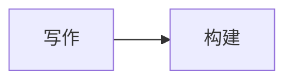
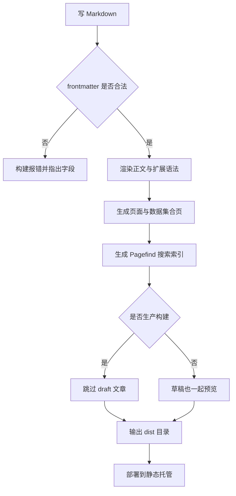
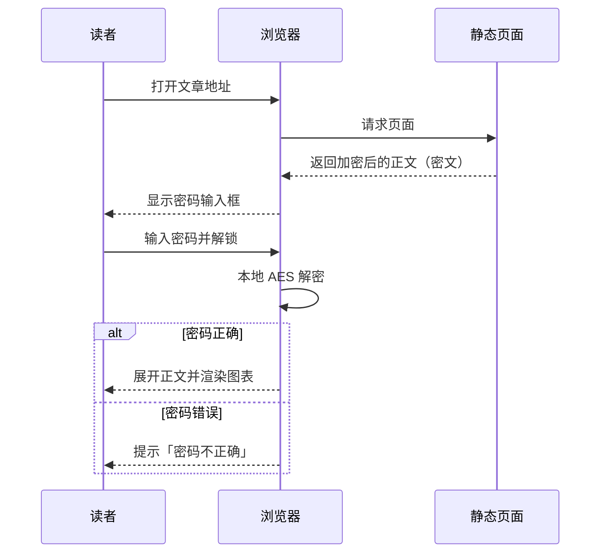
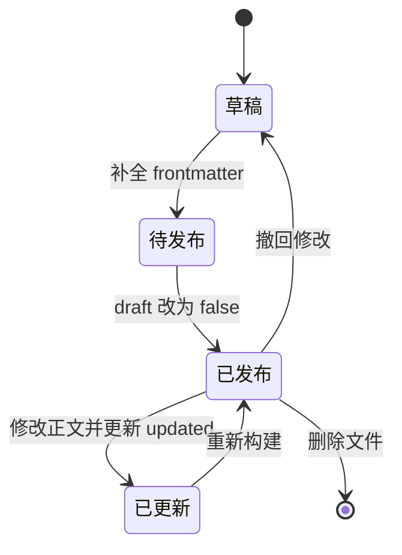
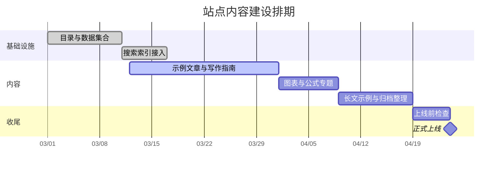
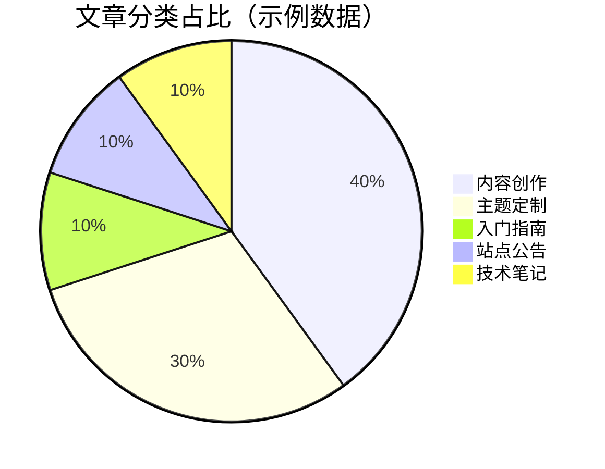

图表和公式是「技术文章值得写下来」的重要原因之一：一张图能替掉三段解释，一个公式能让「大概是这样」变成「就是这样」。

## 为什么用文本画图

Mermaid 的输入是纯文本，输出由浏览器现场渲染。好处很实际：

- 图可以进 Git，改动可 diff、可回溯；
- 换主题、换配色不用重画；
- 不用打开任何绘图软件，写文章时顺手就画了。

写法就是在代码块上标注 `mermaid`：

````markdown

````

## 流程图

从写作到上线，这条链路值得画出来——它解释了为什么「本地能跑」和「线上能跑」是两件事。



:::tip
节点文字里出现 `{}` `[]` `()` 时要用引号包起来，例如 `A["带括号的 (文字)"]`，否则 Mermaid 会把括号当成形状语法。
:::

## 时序图

带交互的功能适合用时序图说清楚「谁在什么时候做了什么」。以访问一篇加密文章为例：



关键结论写在图里了：**解密发生在浏览器本地**，服务端从头到尾只发密文。

## 状态图

文章的「一生」其实是个状态机，用状态图画出来，`draft` 与 `updated` 的作用就一目了然：



## 甘特图

给内容排期的时候，甘特图比待办清单直观：



## 饼图

数据占比这种一眼就懂的东西，交给饼图：



可以放心的是，Mermaid 支持的类型远不止这五种，类图、实体关系图、思维导图、时间线都能写，语法都是同一套「文字描述结构」的思路。

## 数学公式

行内公式写在单个美元符号之间，例如质能方程 $E = mc^2$、求根公式 $x = \frac{-b \pm \sqrt{b^2-4ac}}{2a}$，或者站点里更常见的阅读时长估算 $t = \lceil w / 300 \rceil$。

独立成行的公式用两个美元符号，会居中并单独占一行：

$$
\text{阅读时长（分钟）} = \left\lceil \frac{\text{正文字数}}{300} \right\rceil
$$

### 多行对齐

用 `aligned` 环境可以让等号对齐，推导过程会好读很多：

$$
\begin{aligned}
S(n) &= \sum_{i=1}^{n} i \\
     &= \frac{n(n+1)}{2} \\
     &= \frac{n^2 + n}{2}
\end{aligned}
$$

### 矩阵与分段函数

$$
A = \begin{pmatrix}
a_{11} & a_{12} \\
a_{21} & a_{22}
\end{pmatrix}
\qquad
f(x) =
\begin{cases}
x^2, & x \ge 0 \\
-x,  & x < 0
\end{cases}
$$

### 常用符号速查

| 想要的效果 | 写法 |
| --- | --- |
| 分式 | `\frac{a}{b}` |
| 求和、连乘 | `\sum_{i=1}^{n}`、`\prod_{i=1}^{n}` |
| 积分 | `\int_{0}^{\infty} e^{-x}\,dx` |
| 极限 | `\lim_{x \to 0}` |
| 希腊字母 | `\alpha \beta \gamma \Delta \Omega` |
| 上下标 | `x_i^2`、`a_{n+1}` |
| 向量与范数 | `\vec{v}`、`\lVert v \rVert` |
| 文本混排 | `\text{说明文字}` |

例如把上面几个符号拼起来：

$$
\lim_{n \to \infty} \prod_{k=1}^{n} \left(1 + \frac{1}{k}\right)^{k} \quad \text{与} \quad \int_{0}^{1} x^{\alpha-1}(1-x)^{\beta-1}\,dx = B(\alpha, \beta)
$$

### 几个容易踩的坑

:::warning
**美元符号会被当成公式定界符。** 想写出「价格 100 美元」这种句子时，请写 `100 美元` 而不是 `100$`，否则后面的文字会被解析成公式。
:::

:::note
公式里的反斜杠在 Markdown 中是转义字符，命令行之类的场合请放到行内代码里（`` `\frac` ``），不要直接裸写。
:::

## 组合建议

1. **一篇文章最多两三张图**，超过就说明结构需要重新组织。
2. **公式能简就简**：能一句话说清的结论，不必写成三重积分。
3. **图表要给标题或上下文**，脱离正文的图对读者和搜索引擎都不友好。
4. 图和公式都是纯文本，**改动时优先改文字**，别去调整间距——渲染效果由主题统一控制。
