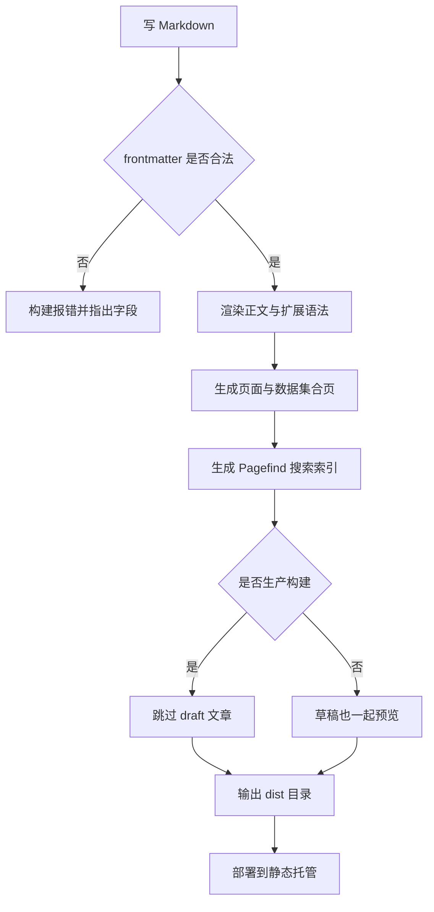
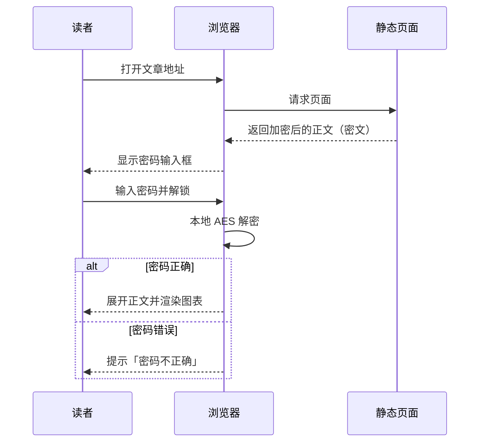
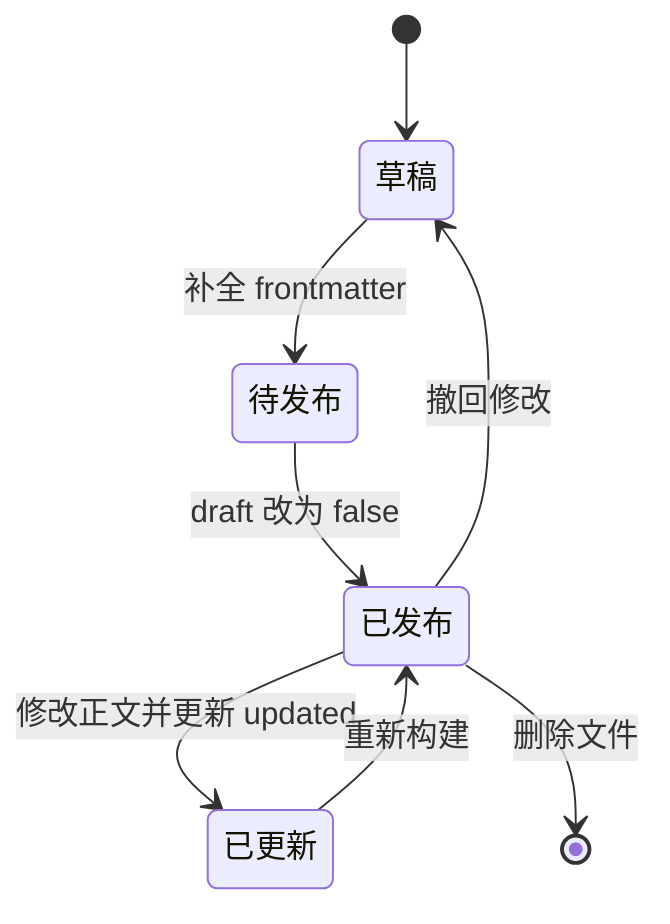
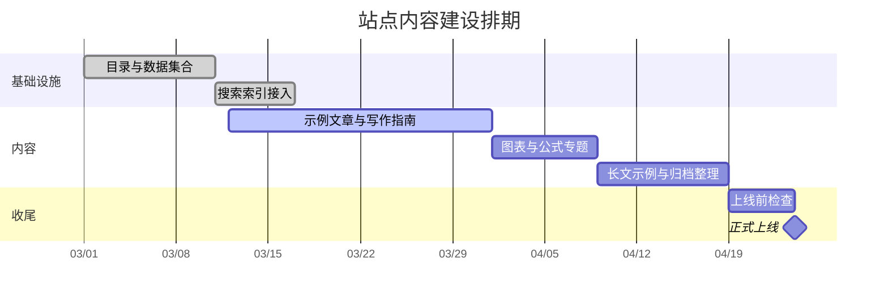
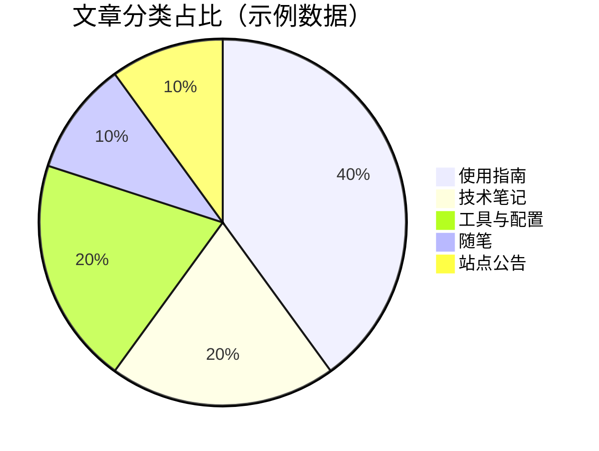

这一页是写给自己的备忘录：需要哪种排版，直接从这里复制写法。文中所有示例都是**真实渲染**的，不是截图。

## 文字样式

**加粗**、*斜体*、~~删除线~~、`行内代码`、[普通链接](https://astro.build/)。上标式的 H~2~O 与 x^2^ 取决于渲染器，不保证全部生效，正式内容里建议少用。

需要打断行时，行尾两个空格即可，例如这一行结尾有两个空格，  
所以这一句出现在了新的一行。

## 标题与目录

正文用 `##` 起步比较合适——文章标题本身已经占掉了最高一级。

### 三级标题

#### 四级标题

标题会自动生成锚点，鼠标悬停时右侧出现 `#`；侧栏的「文章目录」挂件也会按层级同步展开，滚动时高亮当前小节。

## 列表与引用

无序列表：

- 第一项
- 第二项
  - 嵌套一层
  - 再嵌套一层
- 第三项

有序列表：

1. 收集素材
2. 写出草稿
3. 通读一遍并删掉三分之一

任务列表（GitHub 风格）：

- [x] 建好目录结构
- [x] 接入搜索
- [ ] 补齐示例内容
- [ ] 换个自己的域名

引用适合放别人的观点、规范原文或需要特别强调的一段话：

> 引用内部同样支持**行内样式**与列表：
>
> - 一个要点
> - 另一个要点

## 表格

| 列名 | 类型 | 说明 |
| --- | :---: | ---: |
| `title` | 字符串 | 左对齐是默认值 |
| `pinned` | 布尔 | 居中对齐 |
| `published` | 日期 | 右对齐 |

表格支持对齐语法（`:---`、`:---:`、`---:`），单元格里可以用行内代码与链接。

## 代码块

代码块由 Expressive Code 渲染，语言角标、复制按钮、行号都是开箱即用的。

```js
// JavaScript：把文章按发布时间倒序排列
export function sortByPublished(posts) {
    return [...posts].sort((a, b) => new Date(b.published) - new Date(a.published));
}
```

```ts
// TypeScript：给内容集合的字段加上类型
interface PostFrontmatter {
    title: string;
    published: Date;
    tags: string[];
    pinned?: boolean;
}

export function isPinned(post: PostFrontmatter): boolean {
    return post.pinned === true;
}
```

```python
# Python：粗略统计每个标签出现的次数
from collections import Counter

def tag_cloud(posts):
    counter = Counter(tag for post in posts for tag in post["tags"])
    return counter.most_common(10)
```

```json
{
    "title": "示例条目",
    "tags": ["Markdown", "排版"],
    "visible": true
}
```

```bash
# 构建并在本地预览产物
npm run build
npm run preview
```

### 文件名栏、行号与行高亮

在语言后面接 `title="文件名"` 会显示文件栏，`showLineNumbers=true` 打开行号，`ins` / `del` / `mark` 可以标记新增、删除与重点行：

````markdown
```js title="sort-posts.js" showLineNumbers=true ins={4} del={2} mark={6}
```
````

渲染效果如下：

```js title="sort-posts.js" showLineNumbers=true ins={4} del={2} mark={6}
function sortPosts(posts) {
    return posts.sort((a, b) => a.date - b.date);
    const items = [...posts];
    return items.sort((a, b) => new Date(b.published) - new Date(a.published));
    // 下面这一行是这次改动的重点
    console.log("排序完成", items.length);
}
```

### 可折叠代码段

内容很长的代码块可以折叠起来，读者点一下「展开」再看细节。语法是在代码块信息串里写 `collapse={起始行-结束行}`：

````markdown
```ts collapse={2-6}
```
````

实际效果：

```ts collapse={2-6}
export const siteMeta = {
    name: "YouniSekai",
    version: "1.0.0",
    generator: "Astro",
    search: "pagefind",
    comments: false,
};

export function describe() {
    return `${siteMeta.name} v${siteMeta.version}`;
}
```

## 提示框

### 五种类型

:::note
note：需要读者留意、但即使跳读也不该错过的信息。
:::

:::tip
tip：能让人少走弯路的可选建议。
:::

:::important
important：完成某件事所必需的关键信息。
:::

:::warning
warning：存在风险、需要立刻注意的内容。
:::

:::caution
caution：某个操作可能带来的负面后果。
:::

写法是三个冒号包住一段内容：

````markdown
:::note
需要读者留意的信息。
:::
````

### 自定义标题

在类型后面接方括号即可覆盖默认标题：

:::note[这里的标题是我自己写的]
标题支持中英文与行内样式，正文部分照常支持 Markdown。
:::

### GitHub 风格提示框

习惯 GitHub 写法的话，用引用块加类型标记也可以：

> [!TIP]
> 这种写法在 GitHub 上能正确渲染，在本站同样会被识别成提示框。

### 隐藏文本

需要防剧透或者放一点小彩蛋时，用行内指令：

这段内容的结论是 :spoiler[其实答案就在下一段，但我先藏起来了]。

```markdown
这段内容的结论是 :spoiler[其实答案就在这里]。
```

## Mermaid 图表

图表和公式是「技术文章值得写下来」的重要原因之一：一张图能替掉三段解释。

Mermaid 的输入是纯文本，由浏览器现场渲染，好处很实际：图可以进 Git，改动可 diff、可回溯；换主题不用重画；也不用打开任何绘图软件。

### 流程图

从写作到上线，这条链路值得画出来——它解释了为什么「本地能跑」和「线上能跑」是两件事。



:::tip
节点文字里出现 `{}` `[]` `()` 时要用引号包起来，例如 `A["带括号的 (文字)"]`，否则 Mermaid 会把括号当成形状语法。
:::

### 时序图

带交互的功能适合用时序图说清楚「谁在什么时候做了什么」。以访问一篇加密文章为例：



关键结论写在图里了：**解密发生在浏览器本地**，服务端从头到尾只发密文。

### 状态图

文章的「一生」其实是个状态机，用状态图画出来，`draft` 与 `updated` 的作用就一目了然：



### 甘特图

给内容排期的时候，甘特图比待办清单直观：



### 饼图

占比这种一眼就懂的东西，交给饼图（下面是示例数据）：



Mermaid 支持的类型远不止这五种，类图、实体关系图、思维导图、时间线都能写，语法都是同一套「用文字描述结构」的思路。

## 数学公式

行内公式写在单个美元符号之间，例如质能方程 $E = mc^2$、求根公式 $x = \frac{-b \pm \sqrt{b^2-4ac}}{2a}$，或者站点里更常见的阅读时长估算 $t = \lceil w / 300 \rceil$。

独立成行的公式用两个美元符号，会居中并单独占一行：

$$
\text{阅读时长（分钟）} = \left\lceil \frac{\text{正文字数}}{300} \right\rceil
$$

### 多行对齐

用 `aligned` 环境可以让等号对齐，推导过程会好读很多：

$$
\begin{aligned}
S(n) &= \sum_{i=1}^{n} i \\
     &= \frac{n(n+1)}{2} \\
     &= \frac{n^2 + n}{2}
\end{aligned}
$$

### 矩阵与分段函数

$$
A = \begin{pmatrix}
a_{11} & a_{12} \\
a_{21} & a_{22}
\end{pmatrix}
\qquad
f(x) =
\begin{cases}
x^2, & x \ge 0 \\
-x,  & x < 0
\end{cases}
$$

### 常用符号速查

| 想要的效果 | 写法 |
| --- | --- |
| 分式 | `\frac{a}{b}` |
| 求和、连乘 | `\sum_{i=1}^{n}`、`\prod_{i=1}^{n}` |
| 积分 | `\int_{0}^{\infty} e^{-x}\,dx` |
| 极限 | `\lim_{x \to 0}` |
| 希腊字母 | `\alpha \beta \gamma \Delta \Omega` |
| 上下标 | `x_i^2`、`a_{n+1}` |
| 向量与范数 | `\vec{v}`、`\lVert v \rVert` |
| 文本混排 | `\text{说明文字}` |

把上面几个符号拼起来：

$$
\lim_{n \to \infty} \prod_{k=1}^{n} \left(1 + \frac{1}{k}\right)^{k} \quad \text{与} \quad \int_{0}^{1} x^{\alpha-1}(1-x)^{\beta-1}\,dx = B(\alpha, \beta)
$$

### 两个容易踩的坑

:::warning
**美元符号会被当成公式定界符。** 想写「价格 100 美元」这种句子时，请写 `100 美元` 而不是 `100$`，否则后面的文字会被解析成公式。
:::

:::note
公式里的反斜杠在 Markdown 中是转义字符，讲命令行之类的场合请把写法放进行内代码里（`` `\frac` ``），不要直接裸写。
:::

## GitHub 仓库卡片

写一行指令就能得到一张会实时拉取数据的仓库卡片：

::github{repo="withastro/astro"}

```markdown
::github{repo="withastro/astro"}
```

:::note
卡片里的 star 数、协议、语言等信息由访客浏览器现场请求 GitHub API 获取，所以第一次打开时会短暂显示「Waiting...」。仓库名必须写成 `作者/仓库` 的格式。
:::

## 链接与图片

行内链接：[Astro 官方文档](https://docs.astro.build/)、[Pagefind 搜索](https://pagefind.app/)。

图片有两种写法，取决于文件放在哪：

| 写法 | 图片位置 | 适合什么 |
| --- | --- | --- |
| `/assets/images/...` | `public/assets/images/` 下 | 全站复用的封面、头像、占位图 |
| `./xxx.png` | 与当前 Markdown 文件同一个目录 | 跟着这篇文章一起搬家的配图 |

第一种写法直接引用 `public` 目录下的占位图：


第二种写法是相对路径，图片与文章放在一起，构建时会被一并处理：

```markdown

```

:::tip
相对路径（`./xxx.png`）适合会跟着文章搬家的素材；`public` 下的绝对路径（`/assets/...`）适合全站复用的封面与头像。注意相对路径引用的是图片**文件本身**，一旦路径写错，构建会直接报 `ImageNotFound` 而不是静默跳过。
:::

## 组合使用的建议

1. **少即是多**：一篇文章里提示框超过五个，读者就会开始忽略它们。
2. **代码块给语言名**：`bash`、`json`、`ts` 这些标记不仅有配色，也让复制按钮与语言角标更准确。
3. **长代码折叠**：超过 20 行的示例用 `collapse` 折叠，把注意力留给结论。
4. **一篇文章最多两三张图**：超过这个量，说明结构需要重新组织。
5. **图表要给标题或上下文**：脱离正文的图对读者和搜索引擎都不友好。
6. **图片要写替代文本**：方括号里的描述对无障碍阅读与 RSS 都很重要，别留空。

语法速查就到这里。每个 frontmatter 字段的含义见[模板使用指南](/posts/template-guide/)，主题色、侧栏与评论的配置见[站点配置与进阶功能](/posts/site-configuration/)。
